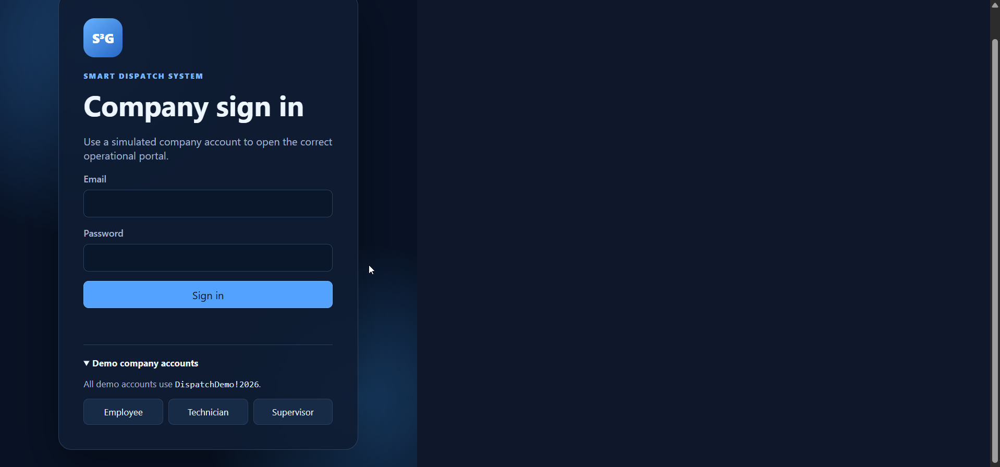
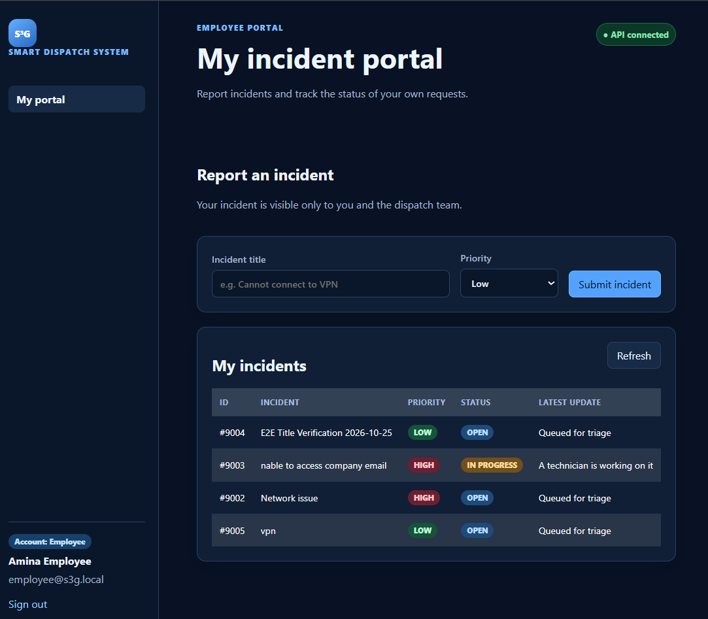
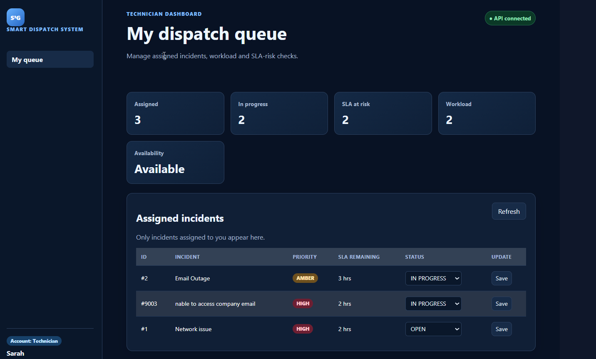
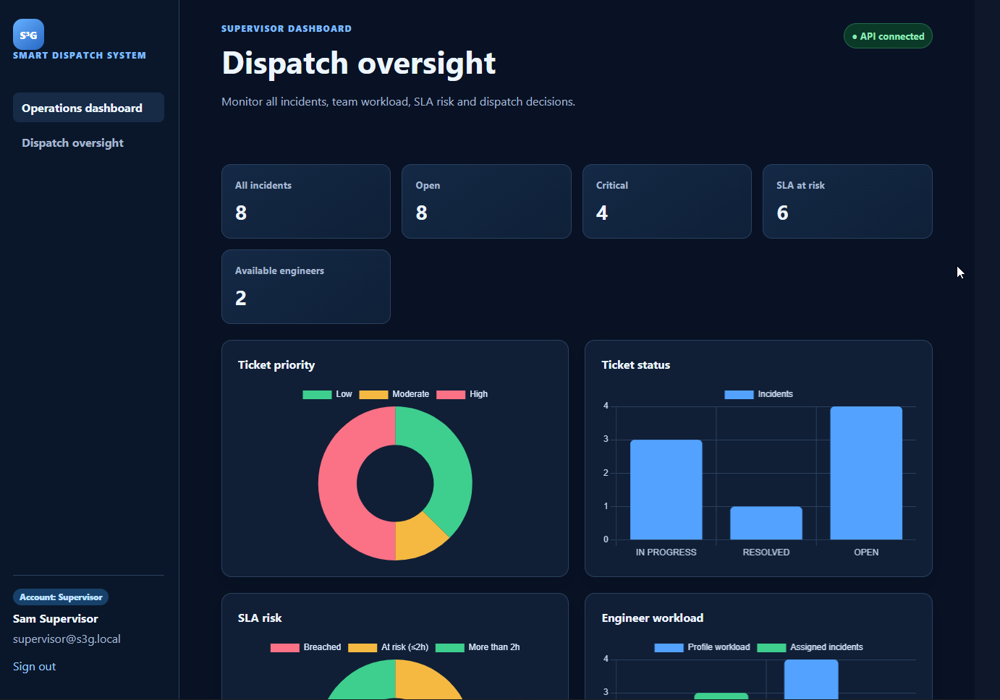
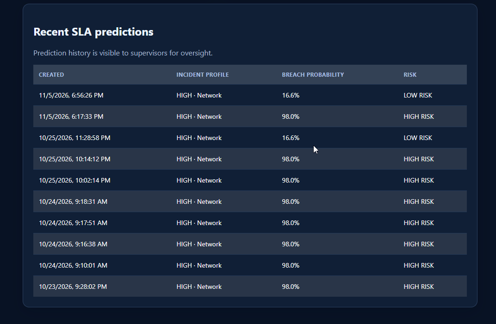
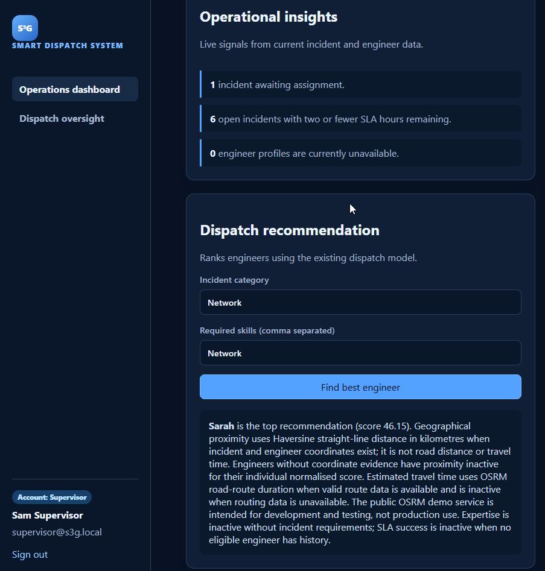

# S³G Smart Dispatch System

**AI-assisted SLA risk prediction and intelligent IT incident dispatch**

[](https://www.python.org/)
[](https://fastapi.tiangolo.com/)
[](https://www.postgresql.org/)
[](https://scikit-learn.org/)

The **S³G Smart Dispatch System** is a prototype IT service management platform designed to support incident handling, predict potential SLA breaches, and recommend suitable field service engineers.

It combines a FastAPI backend, a browser-based role-specific interface, PostgreSQL persistence, machine-learning-based SLA prediction, and weighted engineer-dispatch recommendations.

> **Project status:** Academic prototype. The system has been tested locally but has not been validated in a live enterprise service-desk environment.

**Repository:** https://github.com/Asante071/s3g-smart-dispatch-system-v2

---

## 1. Application Screenshots

The application provides role-specific interfaces for employees, technicians, and supervisors.

<!-- Replace these placeholders with actual screenshots. -->

### Login



### Employee Portal



### Technician Portal



### Supervisor Dashboard



### SLA Prediction



### Engineer Dispatch Recommendations



---

## 2. Key Features

### Role-based portals

The application provides three role-specific interfaces:

- **Employee:** Submit incidents and view personal ticket records.
- **Technician:** View assigned incidents, update ticket statuses, and access SLA predictions for assigned incidents.
- **Supervisor:** Monitor incidents, view operational dashboards, assign engineers, access prediction history, and request dispatch recommendations.

Access to protected operations is controlled by role-based authorization.

### SLA breach prediction

The system uses a Random Forest classification model to estimate the probability that an incident will breach its service-level agreement.

The model uses nine input features:

1. Priority
2. Incident category
3. Complexity
4. Engineer experience
5. Engineer workload
6. Previous incidents
7. Allowed SLA hours
8. Incident age
9. Remaining SLA hours

The model was trained and evaluated using a synthetic dataset of 5,000 incident records.

**Reported holdout evaluation results:**

| Metric | Result |
|---|---:|
| Accuracy | 94.10% |
| Precision | 97.23% |
| Recall | 94.33% |
| F1-score | 95.76% |

These results represent performance on a synthetic holdout dataset. They should not be interpreted as demonstrated performance on real operational incidents.

### Intelligent dispatch recommendations

The dispatch service ranks eligible engineers using a weighted scoring approach:

| Criterion | Weight |
|---|---:|
| Technical expertise | 35% |
| Current workload | 25% |
| Historical SLA success | 15% |
| Geographical proximity | 15% |
| Real-time availability | 5% |
| Estimated travel time | 5% |

Engineer availability is used as an eligibility condition. The scoring service can adjust the active criteria when information is unavailable.

Geographical proximity is calculated using the Haversine distance formula. The routing service can request driving distance and duration from the public OSRM demonstration service.

The recommendation output includes ranking information and score explanations. Results depend on the information available for each engineer and incident.

### Operational dashboard

The supervisor portal includes operational indicators and Chart.js visualizations for:

- Incident priority
- Incident status
- SLA risk
- Engineer workload
- Prediction history
- Dispatch and incident oversight

Dashboard figures reflect the current local application data and are not independently verified enterprise performance measures.

---

## 3. Technology Stack

| Layer | Technology |
|---|---|
| Backend | Python, FastAPI |
| Application server | Uvicorn |
| Frontend | HTML, CSS, JavaScript |
| Charts | Chart.js |
| Database | PostgreSQL |
| ORM | SQLAlchemy |
| Database driver | Psycopg |
| Machine learning | Scikit-learn |
| Data processing | Pandas, NumPy |
| Model persistence | Joblib |
| Testing | Pytest, HTTPX |
| Configuration | python-dotenv |

---

## 4. System Architecture

The application separates API handling, business logic, persistence, machine-learning functionality, and frontend presentation.

```text
s3g-smart-dispatch-system-v2/
│
├── api/
│   └── app.py
│
├── frontend/
│   ├── index.html
│   ├── app.js
│   ├── role-app.js
│   ├── style.css
│   └── role-style.css
│
├── ml/
│   ├── model.py
│   └── artifacts/
│       ├── evaluation_metrics.json
│       └── sla_random_forest.joblib
│
├── services/
│   ├── auth_service.py
│   ├── dispatch_recommendation_service.py
│   ├── engineer_management_service.py
│   ├── prediction_audit_service.py
│   ├── routing_service.py
│   ├── sla_prediction_service.py
│   └── ticket_service.py
│
├── repositories/
│   ├── database_models.py
│   ├── database_ticket_repository.py
│   ├── database_engineer_repository.py
│   ├── database_user_repository.py
│   └── inmemory/
│
├── factories/
│   └── repository_factory.py
│
├── data/
│   ├── generate_dataset.py
│   └── synthetic_incidents.csv
│
├── docs/
│   └── DISPATCH_SCORING.md
│
├── tests/
│   ├── api/
│   └── services/
│
├── database.py
├── requirements.txt
├── README.md
└── .gitignore
```

The repository also contains additional application and supporting modules not shown in this abbreviated structure.

### Persistence

The PostgreSQL implementation uses SQLAlchemy models and repository classes.

The database contains the following tables:

- `tickets`
- `users`
- `engineers`
- `completed_assignments`
- `prediction_audits`

The repository factory supports memory-based or PostgreSQL ticket storage. Engineer and user persistence use PostgreSQL repositories in the current configuration.

---

## 5. Design Patterns and Engineering Practices

The implementation uses established software design approaches, including:

- **Repository pattern:** Separates data access from application services.
- **Factory pattern:** Selects repository implementations.
- **Singleton pattern:** Provides controlled shared-instance behavior where implemented.

Other practices include modular service classes, environment-based configuration, input validation, role-based authorization, and automated tests.

---

## 6. Requirements

The project uses the pinned dependencies in `requirements.txt`.

Key dependencies include:

- FastAPI
- Uvicorn
- SQLAlchemy
- Psycopg
- python-dotenv
- Pytest
- HTTPX
- Pandas
- NumPy
- Scikit-learn
- Faker
- Joblib

Use `requirements.txt` as the authoritative dependency list.

---

## 7. Installation and Setup

### Prerequisites

- Python 3.14 or a compatible supported Python environment
- PostgreSQL database server
- Git
- PowerShell or another terminal

### Clone the repository

```powershell
git clone https://github.com/Asante071/s3g-smart-dispatch-system-v2.git
cd s3g-smart-dispatch-system-v2
```

### Create and activate a virtual environment

```powershell
python -m venv .venv
.\.venv\Scripts\Activate.ps1
```

### Install dependencies

```powershell
python -m pip install --upgrade pip
pip install -r requirements.txt
```

### Configure environment variables

Create a `.env` file in the project root. Configure the following variables using your own local PostgreSQL credentials:

```env
STORAGE_TYPE=POSTGRES

DB_USER=your_database_username
DB_PASSWORD=your_database_password
DB_HOST=localhost
DB_PORT=5432
DB_NAME=s3g_smart_dispatch

AUTH_TOKEN_SECRET=your_long_random_secret
```

Do not commit `.env` files or expose database credentials and authentication secrets in screenshots, logs, or source control.

The application uses PostgreSQL configuration when `STORAGE_TYPE=POSTGRES`. The database must be available and the configured user must have the necessary permissions.

### Start the application

```powershell
uvicorn api.app:app --reload
```

Open the application in your browser:

```text
http://127.0.0.1:8000
```

FastAPI API documentation:

```text
http://127.0.0.1:8000/docs
```

---

## 8. Running the Tests

Run the complete test suite from the project root:

```powershell
pytest -v
```

### Latest recorded test execution

Test execution date: 5 November 2026.

| Result | Count |
|---|---:|
| Tests collected | 39 |
| Passed | 39 |
| Failed | 0 |
| Warnings | To be reverified |

The test suite covers API behavior, authorization, SLA prediction, dispatch recommendations, engineer management, ticket services, repository persistence, and design-pattern behavior.

The published README previously reported one warning, while an earlier test summary recorded 807 warnings. The warning count should be verified with a fresh test run before this section is finalized.

The results describe local test execution and do not establish production readiness.

---

## 9. API Capabilities

The FastAPI application provides functionality for:

- Authentication and current-user information.
- Incident creation, retrieval, assignment, and status updates.
- Employee, technician, and supervisor dashboard data.
- SLA breach prediction and prediction history.
- Engineer profile management.
- Dispatch recommendations.
- Completed assignment and engineer performance records.

For current endpoint definitions and request schemas, consult the running API documentation at `/docs`.

---

## 10. Limitations and Future Improvements

The current implementation is a working academic prototype. The following limitations should be considered:

- **Synthetic training data:** The reported machine-learning metrics are based on generated incident records. Validation against real service-desk data is still required.
- **Authentication integration:** The current login mechanism is a simulated company-account workflow. Enterprise single sign-on, Microsoft Entra ID integration, and multi-factor authentication have not been demonstrated.
- **Routing dependency:** OSRM uses a public demonstration endpoint. Availability, response time, and route accuracy depend on the external service.
- **Dispatch history:** Historical SLA scoring depends on available completed-assignment records. The current local database may not contain sufficient historical records for meaningful operational validation.
- **Security hardening:** Production deployment requires review of CORS settings, secret management, HTTPS, deployment configuration, and access controls.
- **External integrations:** Live integration with platforms such as BMC Helix or ServiceNow has not been demonstrated.

Potential future improvements include real operational training data, model monitoring, enterprise identity integration, a production routing provider, broader automated routing tests, and deployment hardening.

---

## 11. Project Purpose

The project explores how machine learning and decision-support techniques can assist IT service-desk and field-support operations.

Its main objectives are to:

- Predict potential SLA breaches using incident characteristics.
- Recommend suitable engineers using operational and technical criteria.
- Provide role-specific incident management interfaces.
- Improve visibility into incident status, SLA risk, and engineer workload.

The system demonstrates a prototype implementation of these capabilities. Actual reductions in SLA breaches, penalty costs, or operational expenditure have not yet been established through production evaluation.

---

## 12. Repository

**GitHub:** https://github.com/Asante071/s3g-smart-dispatch-system-v2

**Project:** S³G Smart Dispatch System

**Implementation:** Python, FastAPI, PostgreSQL, Scikit-learn, HTML, CSS, JavaScript and Chart.js

---

*Academic prototype developed to explore predictive SLA management and intelligent IT incident dispatch.*
